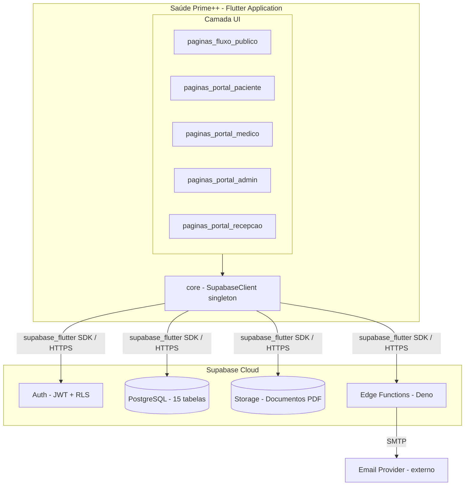
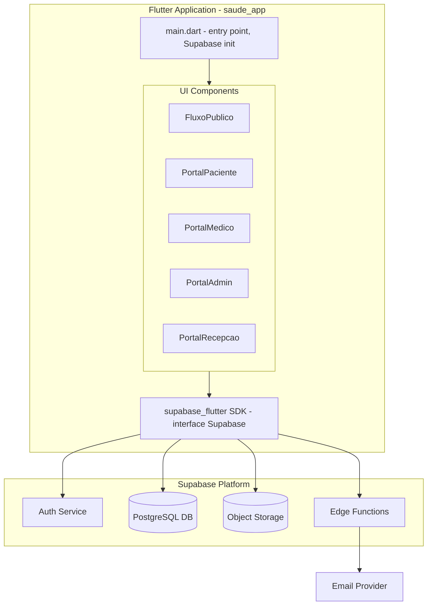
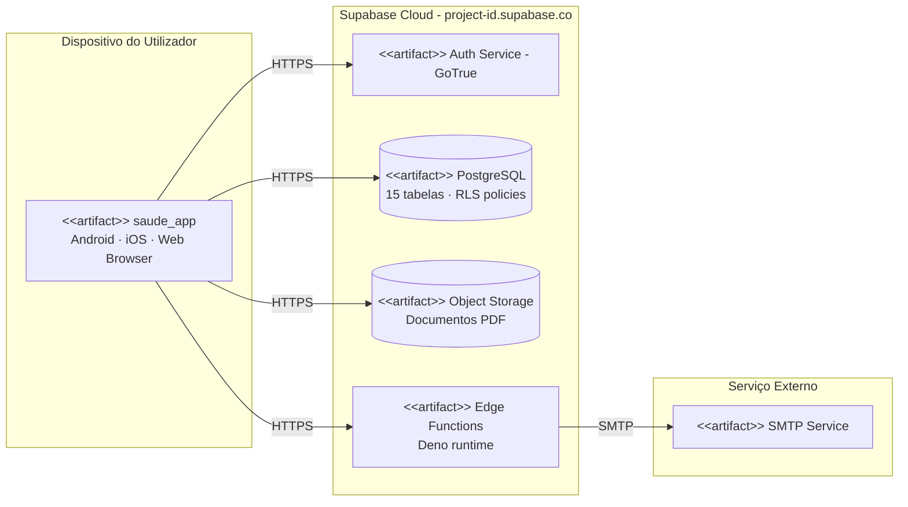
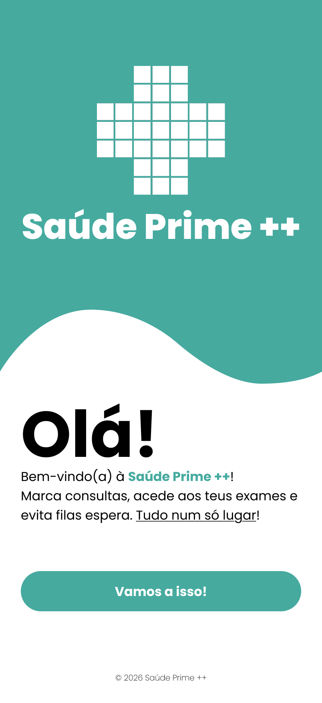
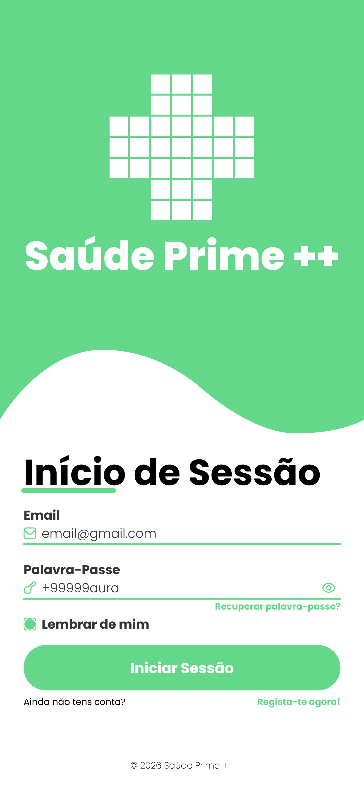

## Arquitectura e Design

A Saúde Prime++ é uma aplicação de gestão clínica multi-perfil construída em Flutter com Supabase como backend. A arquitectura segue um modelo cliente–cloud: uma única base de código Flutter corre em Android, iOS e Web, enquanto toda a persistência de dados, autenticação e lógica de backend ficam no Supabase (PostgreSQL, Auth, Storage e Edge Functions). O controlo de acesso é feito diretamente na base de dados via políticas Row-Level Security (RLS), sem necessidade de um servidor de aplicação dedicado.

---

### Arquitectura Lógica

A Vista Lógica documenta a estrutura de alto nível da base de código como um conjunto de pacotes, independentemente de questões de deployment.

O sistema organiza-se em três camadas horizontais:

**Camada UI** - Cinco pacotes Flutter, um por perfil, cada um com as suas páginas, widgets e navegação:

- `paginas_fluxo_publico` - Ecrãs públicos (Landing, Login, Registo, Recuperação de Password, Termos e Condições). É o ponto de entrada para qualquer utilizador antes de autenticar.
- `paginas_portal_paciente` - Portal do Paciente: Dashboard, Consultas, Detalhes de Consulta, Agendamento (3 passos), Reagendamento, Histórico Clínico, Documentos, Fila Virtual, Notificações e Perfil.
- `paginas_portal_medico` - Portal do Médico: Dashboard, Agenda, Consulta, Marcar Consulta, Bloqueio de Horário, Envio de Documentos, Pesquisa de Paciente, Dados do Paciente e Fila Virtual.
- `paginas_portal_admin` - Portal do Admin: Dashboard, Lista de Utilizadores, Perfil de Utilizador, Novo Utilizador, Alteração de Permissões, Exportação de Relatórios, Newsletter e Agendas.
- `paginas_portal_recepcao` - Portal da Receção: Dashboard, Gestão de Pacientes, Novo Paciente, Edição de Paciente (abas: Dados e Consultas), Agendamentos, Fila Virtual e Definições.

**Camada Core** - O pacote `core` expõe o singleton do cliente Supabase (`supabase.dart`), partilhado por todos os portais. Todas as chamadas de rede passam por aqui.

**Camada Backend (Supabase Cloud)** - Externa à base de código Flutter:

- `Auth` - Autenticação JWT e gestão de sessão, com propagação de role via custom claims.
- `Database` - PostgreSQL com 15 tabelas (`users`, `patients`, `doctors`, `appointments`, `virtual_queue`, `documents`, `notifications`, `audit_log`, etc.) e políticas RLS que aplicam controlo de acesso por role.
- `Storage` - Armazenamento de objectos para documentos clínicos (PDFs de análises, receitas e facturas).
- `Edge Functions` - Funções serverless em Deno (`notify-cancellation`, `notify-document`, `send-newsletter`, `send-reminders`), invocadas por triggers de BD e chamadas directas do cliente.

---

### Arquitectura Física

#### Vista de Implementação

A Vista de Implementação mapeia os componentes de software, as interfaces que expõem e as dependências que consomem.

Há três grupos de componentes principais:

**Flutter Application** - A app Flutter compilada é um único binário que incorpora os cinco portais. Comunica com o Supabase exclusivamente pelo SDK `supabase_flutter` (v2.12.4), que trata das ligações REST e WebSocket. Não existe servidor de aplicação: toda a lógica de negócio fica no cliente Flutter ou nas Edge Functions. O `main.dart` inicializa o Supabase e encaminha o utilizador para o portal correcto com base no `role` após autenticação.

**Supabase Platform** - Funciona como backend completo. O `Auth Service` gere registo, login, renovação de sessão e verificação de role. O `PostgreSQL DB` guarda todos os dados clínicos e operacionais; as políticas RLS em cada tabela controlam o acesso (por exemplo, um paciente só vê as suas próprias consultas). O `Object Storage` gere os PDFs clínicos, acedidos pelo cliente via URLs assinados. As `Edge Functions`, em Deno, tratam dos efeitos secundários assíncronos: emails de cancelamento, notificações de upload, newsletters e lembretes de consultas.

**Email Provider** - Serviço SMTP externo chamado pelas Edge Functions. É a única dependência fora da plataforma Supabase.

#### Vista de Deployment

A Vista de Deployment descreve os nós físicos ou cloud onde cada artefacto corre e como comunicam entre si.

Existem três nós de deployment:

**Dispositivo do Utilizador** - Smartphone Android, dispositivo iOS ou browser Web. Executa o binário `saude_app` compilado via `flutter build apk`, `flutter build ios` ou `flutter build web`. A app não guarda dados clínicos localmente, à excepção do token de sessão ativo (gerido pelo Supabase SDK).

**Supabase Cloud** - Plataforma gerida que aloja o serviço de autenticação `GoTrue`, uma instância `PostgreSQL` com RLS, um serviço de `Object Storage` e um runtime `Deno` para as Edge Functions. Toda a comunicação do cliente usa um único endpoint HTTPS (`<project-id>.supabase.co`).

**Email Provider** - Serviço SMTP externo, invocado pelas Edge Functions via HTTP quando consultas são canceladas, documentos carregados, newsletters enviadas ou lembretes disparados.

---

### Protótipo Vertical

O protótipo vertical, lançado como **v0.0**, serviu para validar a decisão arquitetural central: usar Flutter como framework cross-platform ligado ao Supabase como Backend-as-a-Service.

Foram implementados a **Landing Page** e o **Login Screen** (base da US1 - autenticação). A escolha não foi arbitrária: estes dois ecrãs representam o corte transversal mais estreito de toda a stack. Um widget Flutter renderiza a UI, `core/supabase.dart` expõe o singleton `Supabase.instance.client`, e o `main.dart` inicializa a ligação ao projeto Supabase. Este corte confirmou três coisas:

1. O Flutter consegue inicializar e comunicar com o Supabase em Android e Web;
2. O sistema de templates visuais (`TemplateFluxoPublico`) funciona como base reutilizável para os restantes ecrãs do fluxo público;
3. A arquitectura de pacotes por portal (`paginas_fluxo_publico/`, `core/`) é viável e escala bem para as iterações seguintes.

O protótipo tinha 6 ficheiros Dart: `main.dart`, `core/supabase.dart`, `paginas_fluxo_publico/landing_page.dart`, `paginas_fluxo_publico/login_page.dart` e os dois templates partilhados. Os restantes 64 ficheiros do v3.0 final foram construídos em cima desta base.

  
  &nbsp;&nbsp;&nbsp;
  

