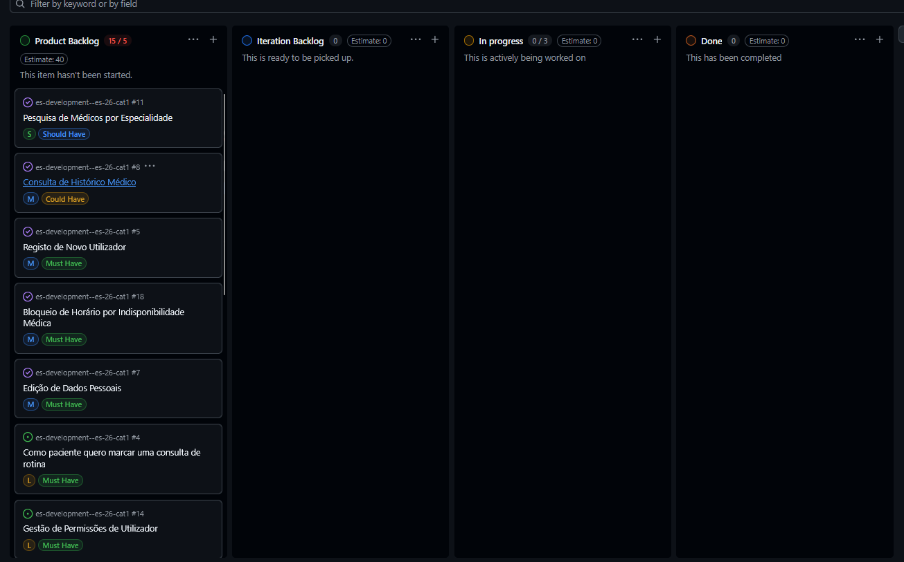
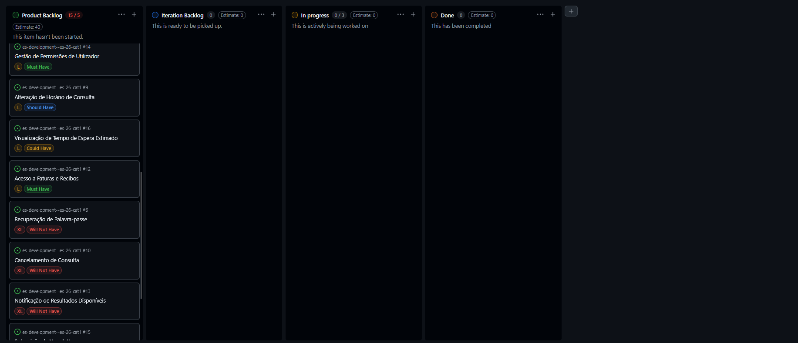
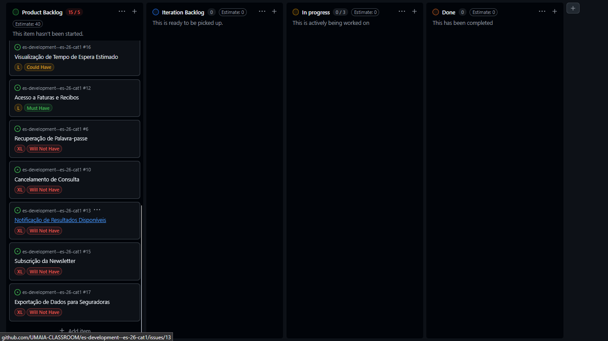

# Iteration 1 Log

## Release

https://github.com/UMAIA-CLASSROOM/es-development--es-26-cat1/tree/main/releases/v1.0/saude_app

## Sprint Retrospective

### What went well?
- We did all of the frontend
- We made the base for some of the User Stories
- We distributed well the tasks, and made it in time

### What should we do differently?
- We should have planned better the pages in figma

### What still puzzles me?

- How to implement the database

## Project Board

### Beginning of the sprint.

### End of the sprint.

