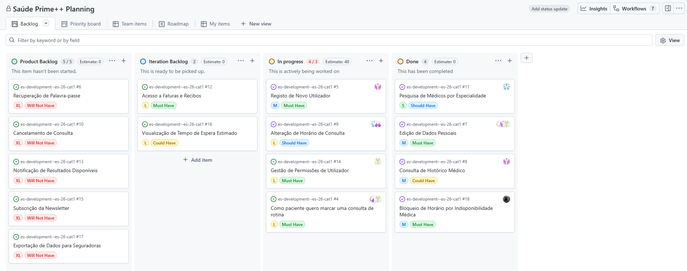
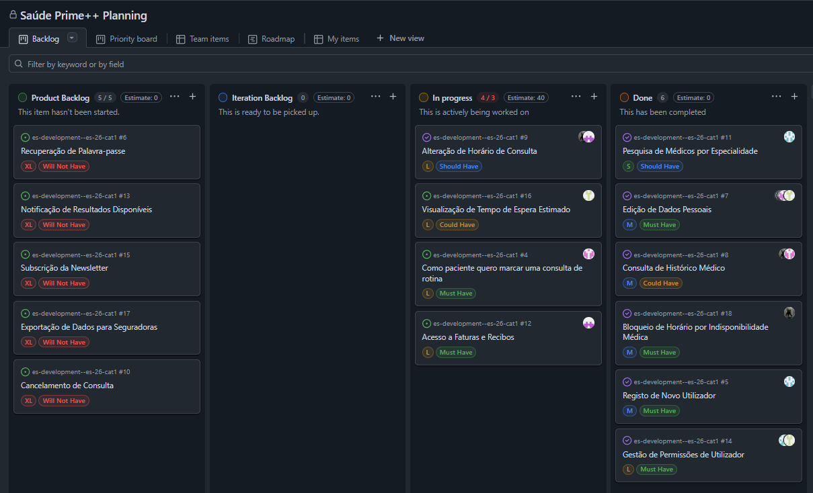

# Iteration 2 Log

## Release

https://github.com/UMAIA-CLASSROOM/es-development--es-26-cat1/tree/main/releases/v2.0/saude_app

## Sprint Retrospective

### What went well?
- We successfully integrated the Supabase backend, enabling real authentication and role-based routing across all four portals (Patient, Doctor, Receptionist, Admin)
- We completed 6 user stories, all of which are now connected to the live database
- The team distributed tasks effectively and delivered a working, usable release

### What should we do differently?
- Some screens still use mock data; we should prioritise replacing those with real database queries in the next sprint
- We should write automated tests alongside feature development instead of leaving them for later

### What still puzzles me?
- How to best handle real-time updates (example: virtual queue state) using Supabase subscriptions
- How to structure automated acceptance tests for a Flutter + Supabase app

## Project Board

### Beggining of the sprint.

### End of the sprint.

