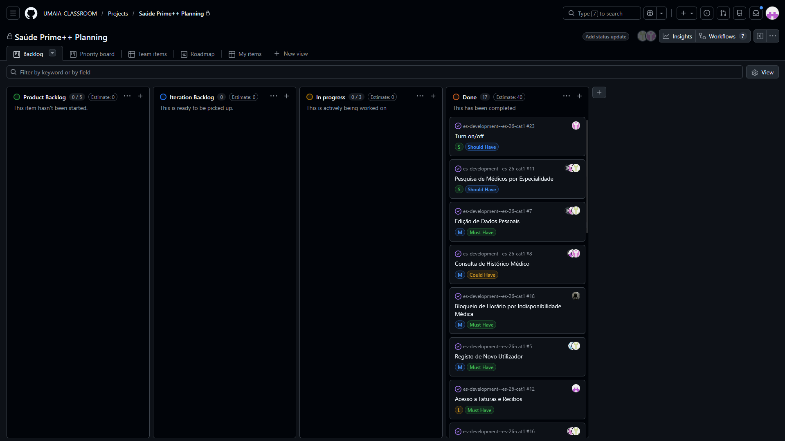

# Iteration 3 Log

## Release
https://github.com/UMAIA-CLASSROOM/es-development--es-26-cat1/tree/main/releases/v3.0

## Sprint Retrospective

### What went well?

- Fechámos 14 user stories até ao fim da iteração, incluindo todos os Must Have (Registo, Edição de Dados Pessoais, Bloqueio de Horário do Médico, Histórico Clínico, Pesquisa por Especialidade)
- A integração com o Supabase - que nos deu dores de cabeça na Iteração 1 - está agora a funcionar em todos os quatro portais, com as políticas RLS a aplicar o controlo de acesso por role
- Implementámos as Edge Functions para as funcionalidades assíncronas (notificações de cancelamento de consultas, alertas de upload de documentos, envio de newsletters e lembretes de consultas), que foram tecnicamente o maior desafio de todo o projecto

### What should we do differently?

- Devíamos ter começado os testes automáticos mais cedo em vez de os deixar para a iteração final; escrever os testes a par das funcionalidades teria sido muito menos stressante
- Alguns ecrãs ainda tinham dados mock no início desta iteração, o que obrigou a retrabalho que teria sido evitável com melhor planeamento da camada de dados na Iteração 2
- As user stories maiores (L/XL) deviam ter sido partidas em tarefas mais pequenas no board, para termos melhor visibilidade do progresso ao longo do sprint

### What still puzzles me?

- Como escrever testes de aceitação automáticos fiáveis para uma app Flutter + Supabase sem ter de levantar um ambiente de teste completo com base de dados real
- Qual a melhor abordagem para lidar com atualizações em tempo real (por exemplo, mudanças de estado na fila virtual) usando Supabase Realtime a uma escala maior
- Como estruturar release notes e versionamento de forma consistente quando os quatro portais partilham uma única base de código

## Project Board

### Início do sprint.

### Fim do sprint.
