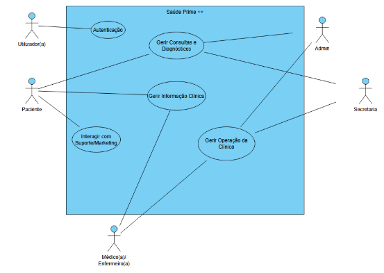
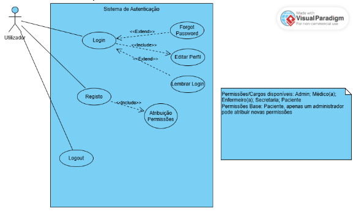
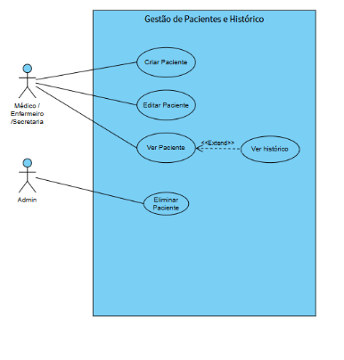
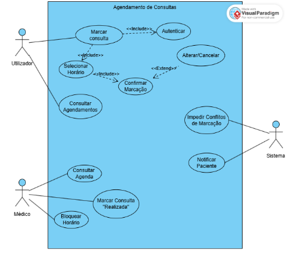
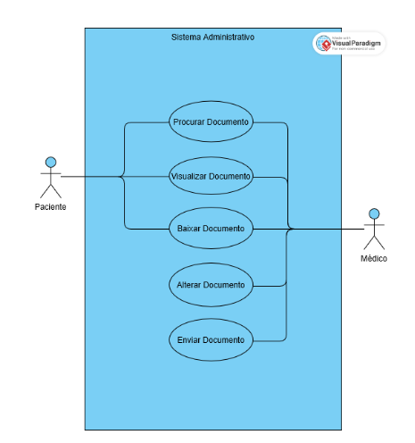
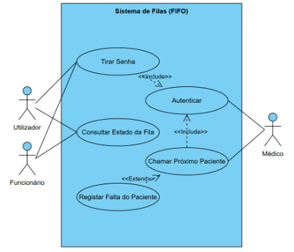
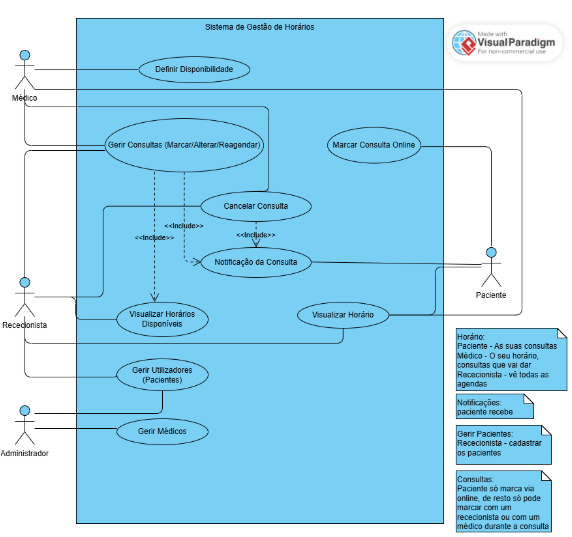
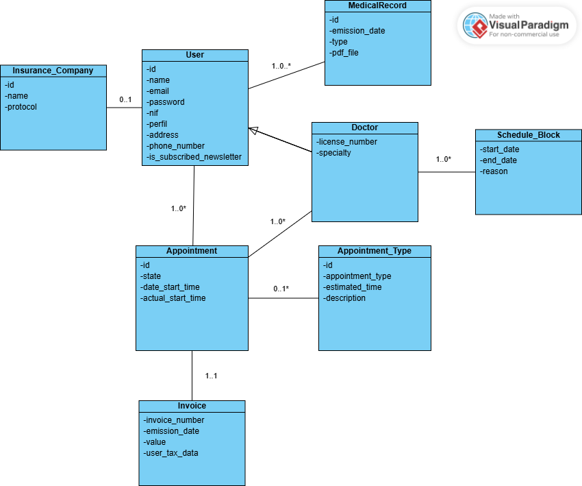

# Requirements Engineering

# Requisitos Funcionais  

## Autenticação e Gestão de Utilizadores    
  
- **RF1.1**: o sistema deve ter sign up que faça a autenticação do utilizador (paciente, médico, admin, rececionista,...), com diferenças de permissões  
- **RF1.2**: o sistema deve permitir login através de email e palavra-passe  
- **RF1.3**: deve ter recuperação de palavra-passe  
- **RF1.4**: logout

## Gestão de Pacientes e Histórico  

- **RF2.1**: sistema deve permitir o registo/edição/eliminação/visualização de pacientes (com os respetivos utilizadores autorizados)  
- **RF2.2**: sistema deve ter/criar histórico de consultas/análises/diagnósticos dos pacientes (apenas visto por utilizadores com permissão)  
- **RF2.3**: sistema deve manter os dados clínicos restringidos aos respetivos médicos e pacientes  

## Agendamento de Consultas  

- **RF3.1**: sistema deve permitir agendar/editar/adiar/cancelar consultas (com os respetivos utilizadores autorizados)  
- **RF3.2**: deve ter sistema de notificações para o paciente sobre a consulta  
- **RF3.3**: deve ser possível consultar horários e agendamentos (disponibilidade do médico para os rececionistas, agenda do médico para o mesmo, hora dos pacientes para estes, etc)  

## Acesso e Transferência de Documentos Clínicos

- **RF4.1**: deve ser possível procurar/visualizar/baixar/alterar/enviar documentos, para os respetivos utilizadores com permissões para cada

## Sistema de Fila Virtual  

- **RF5.1**: deve haver um sistema de senhas para ordem de atendimento dos pacientes  
- **RF5.2**: deve ser possível inscrever ou não o paciente, se este compareceu ou não (por quem é autorizado)
- **RF5.3**: deve ser possível consultar o estado da fila (por quem é autorizado)  

## Gestão de Horários Médicos  

- **RF6.1**: deve haver gestão de horários dinâmica conforme a gestão das consultas  
  
# Requisitos Não Funcionais 

## Performance
- **RNF1**: O sistema deve responder às ações do utilizador em menos de 2 segundos; 
- **RNF2**:  O sistema deve suportar múltiplos acessos em simultâneo sem impactos negativos no seu desempenho;
## Security
- **RNF3**: Os dados dos pacientes devem ser encriptados; 
- **RNF4**: O acesso deve ser feito por login e password;
- **RNF5**:  O sistema deve conter diferentes níveis de acesso (para médicos, pacientes, rececionistas, etc);
- **RNF6**: O sistema deve realizar backups diários(?) em caso de falha, para prevenir a perda de dados
## Usability
- **RNF7**: O sistema deve ser intuitivo, de modo a ser de fácil utilização para novos utilizadores; 
- **RNF8**: O sistema deve ser compatível com computadores e telemóveis;
## Reliability
- **RNF9**: O sistema deve estar disponível 99.9% do tempo no período de um ano;
## Scalability
- **RNF10**: O sistema deve suportar o aumento de pacientes registrados sem haver impactos negativos no sistema;
- **RNF11**: O sistema deve ser possível adicionar novos pacientes/médicos/etc;
## Maintainability
- **RNF12**: O sistema não deve ser interrompido durante atualizações;
## Portability
- **RNF13**: O sistema deve ser compatível com diferentes navegadores; 
- **RNF14**: O sistema deve ser compatível com diferentes resoluções de tela;
- **RNF15**: O sistema deve poder ser acedido via web sem necessidade de instalação

## Use Case Model 

### Use Case Geral

    

|||
| --- | --- |
| *Nome* | Gestão Integrada de Saúde Prime ++ |
| *Atores* | Utilizador(a), Paciente, Médico(a)/Enfermeiro(a), Secretaria, Admin |
| *Descrição* | Este caso de uso descreve a interação global entre os diferentes perfis de utilizadores e os módulos principais do sistema: Autenticação, Gestão de Consultas/Diagnósticos, Informação Clínica, Operação da Clínica e Suporte. |
| *Pré-condições* | - O sistema deve estar online e com a base de dados operacional.   - Os utilizadores devem possuir credenciais válidas (exceto para o fluxo de primeiro registo). |
| *Pós-condições* | - Todas as ações (marcações, diagnósticos, alterações de perfil) são registadas com logs de auditoria.   - A base de dados clínica e administrativa é atualizada em tempo real.   - Notificações automáticas são enviadas aos intervenientes quando aplicável. |
| *Fluxo Normal* | **1. Autenticação (Relacionado ao UC #1):**   Qualquer **Utilizador** inicia o processo através do módulo de Autenticação; o sistema valida o perfil (Paciente, Médico, etc.) e liberta as funcionalidades correspondentes.    **2. Gerir Consultas e Diagnósticos (Relacionado aos UC #3, #5 e #6):**   O **Paciente** e a **Secretaria** interagem com o sistema para agendar e confirmar consultas; o **Médico** gere a sua agenda e utiliza a "Fila Virtual" para chamar pacientes; o sistema valida conflitos de horário e gere as senhas de atendimento.    **3. Gerir Informação Clínica (Relacionado aos UC #2 e #4):**   O **Médico/Enfermeiro** insere diagnósticos, cria e altera documentos clínicos e gere o histórico do paciente; o **Paciente** acede ao módulo para visualizar e descarregar os seus documentos e histórico clínico; a **Secretaria** pode consultar dados básicos do paciente para suporte administrativo.    **4. Gerir Operação da Clínica (Relacionado aos UC #2, #5 e #6):**   A **Secretaria** e o **Admin** gerem o fluxo da clínica, incluindo a criação de novos perfis de pacientes e a configuração geral de horários; o **Admin** possui a permissão exclusiva para eliminar registos ou atribuir permissões especiais de cargo.    **5. Interagir com Suporte/Marketing:**   O **Paciente** utiliza este canal para tirar dúvidas ou receber comunicações da clínica. |
| *Fluxos Alternativos e Exceções* | - [Falha de Acesso] Se o módulo de Autenticação falhar, todos os outros módulos ficam inacessíveis para o utilizador.   - [Conflito de Operação] Se dois utilizadores (ex: Médico e Secretaria) tentarem alterar o mesmo horário ou documento simultaneamente, o sistema aplica regras de bloqueio de escrita e notifica o segundo utilizador.   - [Restrição de Perfil] Se um **Paciente** tentar aceder a "Gerir Operação da Clínica", o sistema bloqueia o acesso por falta de permissões (Relacionado ao UC #1 e #6).   - [Indisponibilidade de Dados] Caso um documento ou histórico não seja encontrado, o sistema sugere o contacto com o suporte ou verifica se o registo foi eliminado pelo Admin. |

## Use Case #1

    

|||
| --- | --- |
| *Nome* | Sistema de Autenticação e Gestão de Perfil |
| *Ator* | Utilizador (Paciente, Médico, Enfermeiro, Secretaria, Admin) |
| *Descrição* | O sistema gere o acesso dos utilizadores através de login, registo de novas contas com atribuição de permissões e edição de perfis. |
| *Pré-condições* | - Para o **Registo**, o utilizador deve possuir dados de identificação válidos.   - Para o **Login**, a conta deve ter sido previamente criada e ativada. |
| *Pós-condições* | - O utilizador obtém uma sessão ativa com permissões específicas ao seu cargo.   - Em caso de registo, uma nova conta é criada com o perfil base de "Paciente" (salvo intervenção do Admin). |
| *Fluxo Normal* | 1. O utilizador acede ao sistema e escolhe entre **Login** ou **Registo**.   2. **No fluxo de Login:** o utilizador insere as suas credenciais; o sistema valida os dados e inicia a sessão; o sistema permite a atualização/consulta do perfil.   3. **No fluxo de Registo:** o utilizador preenche o formulário de inscrição; o sistema cria a conta e atribui permissões (definindo o nível de acesso).   4. O utilizador pode encerrar a sessão a qualquer momento através do **Logout**. |
| *Fluxos Alternativos e Exceções* | - [Forgot Password] Caso o utilizador falhe o login ou não se lembre da password, pode ativar a recuperação de conta.   - [Lembrar Login] O utilizador pode optar por manter a sessão iniciada para acessos futuros no mesmo dispositivo.   - [Atribuição de Permissões Especiais] Por padrão, novos registos recebem a permissão "Paciente". Se o cargo for Médico, Enfermeiro ou Secretaria, um Administrador deve intervir manualmente para alterar a permissão.   - [Credenciais Inválidas] O sistema informa o erro e permite novas tentativas ou o reset da password. |

## Use Case #2

    

|||
| --- | --- |
| *Nome* | Gestão de Pacientes e Histórico |
| *Ator* | Médico / Enfermeiro / Secretaria e Admin |
| *Descrição* | O sistema permite a gestão completa do ciclo de vida dos dados do paciente, desde o seu registo inicial até à consulta do seu histórico clínico e remoção de dados. |
| *Pré-condições* | - O utilizador deve possuir as permissões adequadas.   - O paciente deve estar previamente registado no sistema para as ações de edição, visualização ou eliminação. |
| *Pós-condições* | - A base de dados de pacientes é atualizada (em caso de edição ou remoção de dados).   - O histórico clínico é mantido de forma íntegra para consultas futuras. |
| *Fluxo Normal* | 1. O utilizador (Médico/Enfermeiro/Secretaria) seleciona a opção **Criar Paciente** para inserir um novo registo.   2. O sistema valida e guarda os dados do novo paciente.   3. Para consultar dados, o utilizador seleciona **Ver Paciente**.   4. O sistema apresenta os dados básicos do paciente.   5. Se necessário, o utilizador seleciona **Editar Paciente** para atualizar informações existentes.   6. O **Admin** pode selecionar a opção **Eliminar Paciente** para remover registos do sistema. |
| *Fluxos Alternativos e Exceções* | 3. [Ver Histórico] Durante a visualização de um paciente (**Ver Paciente**), o utilizador pode optar por expandir a consulta para **Ver histórico**, detalhando eventos clínicos anteriores.   4. [Permissão Negada] Se um utilizador sem perfil de Admin tentar aceder à função de eliminar, o sistema bloqueia a ação e exibe uma mensagem de erro.   5. [Paciente Não Encontrado] Caso a pesquisa para visualização ou edição não retorne resultados, o sistema informa que o paciente não consta na base de dados. |

## Use Case #3

    

|||
| --- | --- |
| *Nome* | Agendamento de Consultas |
| *Atores* | Utilizador (Paciente), Médico e Sistema |
| *Descrição* | O sistema permite que o Utilizador marque, altere ou consulte consultas, enquanto o Médico gere a sua disponibilidade e o Sistema garante a integridade dos dados e as notificações. |
| *Pré-condições* | - O Utilizador ou o Médico devem estar autenticados no sistema.   - O sistema deve estar operacional e com ligação à base de dados de horários. |
| *Pós-condições* | - O estado da agenda é atualizado em tempo real para evitar sobreposições.   - O paciente e o médico recebem as atualizações pertinentes. |
| *Fluxo Normal* | **1. Fluxo do Utilizador (Marcar Consulta)**   1. O **Utilizador** autentica-se no sistema (Include: Autenticar).   2. Seleciona a opção "Marcar Consulta".   3. O sistema solicita a "Seleção de Horário".   4. Após escolher, o utilizador deve "Confirmar Marcação".   5. **Fluxo Alternativo (Extend):** O utilizador pode optar por "Alterar ou Cancelar" uma marcação já existente a partir do ecrã de confirmação/consulta.    **2. Fluxo do Médico (Gestão da Agenda)**   1. O **Médico** acede à opção "Consultar Agenda".   2. Pode selecionar "Bloquear Horário" para períodos em que não estará disponível.   3. Após o atendimento, o médico seleciona "Marcar Consulta como Realizada" para atualizar o histórico do paciente.    **3. Fluxo do Sistema (Processos Automáticos)**   1. O **Sistema** executa o caso de uso "Impedir Conflitos de Marcação" sempre que um horário é selecionado, garantindo que dois utilizadores não marquem o mesmo slot simultaneamente.   2. O **Sistema** executa o caso de uso "Notificar Paciente" após qualquer confirmação, alteração ou cancelamento de consulta. |
| *Fluxos Alternativos e Exceções* | - [Falha na Autenticação] Se o utilizador não conseguir autenticar-se, o sistema impede o acesso às funções de marcação e solicita a recuperação de palavra-passe.   - [Conflito de Horário] Se dois utilizadores tentarem confirmar o mesmo horário ao mesmo tempo, o sistema processa o primeiro e exibe uma mensagem de "Horário Indisponível" para o segundo, sugerindo nova seleção.   - [Cancelamento Tardio] Se o utilizador tentar cancelar uma consulta fora do prazo permitido, o sistema exibe uma mensagem de erro informando as políticas da clínica. |

## Use Case #4

    

|||
| --- | --- |
| *Atores* | Paciente / Médico |
| *Descrição* | Na plataforma administrativa do sistema clínico, o **Paciente** pode: procurar um documento clínico, visualizar o documento e fazer download/guardar o documento.   O **Médico** pode: alterar um documento clínico, enviar um documento para o sistema e guardar o documento no sistema. |
| *Pré-condições* | - O Paciente está autenticado no sistema.   - O Médico está autenticado no sistema.   - O documento clínico existe no sistema (ou pode ser criado pelo médico). |
| *Pós-condições* | - O documento é armazenado corretamente no sistema.   - O documento fica disponível para consulta pelo paciente (caso autorizado).   - Todas as alterações ficam registadas (ex: histórico ou log de alterações). |
| *Fluxo Normal* | 1. O Médico autentica-se no sistema.   2. O Médico cria ou altera um documento clínico.   3. O Médico guarda ou envia o documento no sistema.   4. O Paciente autentica-se no sistema.   5. O Paciente procura o documento.   6. O sistema apresenta o documento.   7. O Paciente visualiza e pode fazer download do documento. |
| *Fluxos Alternativos e Exceções* | - [Documento não encontrado] No passo 5, o paciente procura um documento; o sistema não encontra nenhum documento correspondente; o sistema apresenta a mensagem: "Documento não encontrado."   - [Falha na autenticação] No momento do login, o sistema rejeita as credenciais inválidas e o acesso é negado.   - [Falha ao guardar documento] No passo 3, o médico tenta guardar o documento; ocorre erro no sistema (ex: falha de rede); o sistema apresenta mensagem de erro; o documento não é guardado.   - [Acesso não autorizado] O paciente tenta aceder a um documento que não lhe pertence; o sistema bloqueia o acesso; o sistema apresenta a mensagem: "Acesso não autorizado." |

## Use Case #5

    

|||
| --- | --- |
| *Atores* | Utilizador, Funcionário, Médico |
| *Descrição* | O sistema de Fila Virtual gere o fluxo de clientes que esperam a sua vez para serem atendidos. Os pacientes podem tirar um *ticket* e esperam a sua vez. Sendo que a fila avança conforme o próximo paciente é chamado pelo médico após atendimento ou falta de comparência do paciente. |
| *Pré-condições* | - Sistema de filas deve estar operacional.   - Sistema de autenticação deve estar a funcionar, e com as devidas permissões dependendo de qual utilizador esteja autenticado. |
| *Pós-condições* | - Sistema de filas fornece os tickets com o número de atendimento.   - O estado da fila é atualizado conforme um paciente é chamado ou quando é marcada a sua ausência. |
| *Fluxo Normal* | 1. O utilizador acede ao sistema de filas e seleciona a opção para retirar uma senha.   2. O sistema gera um número de senha único e adiciona o utilizador à fila.   3. Os funcionários podem aceder ao sistema para consultar o estado atual da fila.   4. O médico autentica-se no sistema para aceder às funções, chamar próximo paciente.   5. O estado da fila é atualizado e o próximo paciente é chamado. |
| *Fluxos Alternativos e Exceções* | - [Ausência do paciente] Se o paciente chamado não aparecer, os funcionários/médicos podem registá-lo como ausente, e o sistema chama o próximo paciente.   - [Falha de autenticação] Se o utilizador fornecer credenciais incorretas, o sistema nega o acesso e solicita uma autenticação novamente.   - [Fila vazia] Sistema demonstra se existe ou não *tickets* tirados a seguir ao número atual dos membros da clínica, ou seja, se há um paciente seguinte ou não.   - [Erro do sistema] Se o sistema não conseguir gerar senhas ou obter os dados da fila, é apresentada uma mensagem de erro e a ação é cancelada. |

## Use Case #6

    

|||
| --- | --- |
| *Nome* | Gestão de Horários |
| *Atores* | Médico, Rececionista, Administrador, Paciente |
| *Descrição* | O utilizador tem acesso a horários que são, por sua vez, alterados dinamicamente através da gestão de consultas pelos autorizados. Se for paciente, recebe uma notificação. |
| *Pré-condições* | - O utilizador necessita de ter sessão iniciada, e as suas respetivas permissões.   - Sistema tem de estar operacional e com acesso à base de dados. |
| *Pós-condições* | - Utilizador tem acesso ao horário, cada um com a respetiva autorização (médico: agenda, horários com disponibilidade; rececionista: horários disponíveis do médico; paciente: horário das consultas marcadas).   - Caso seja um paciente e tenha marcado/confirmado uma consulta ou se o seu médico cancelar a consulta ou alterar a data, o paciente recebe notificação.   - Sistema atualiza os horários de forma dinâmica. |
| *Fluxo Normal* | 1. O utilizador inicia a sessão no sistema.   2. O utilizador acede à funcionalidade "Gestão de Horários".   3. O sistema verifica as permissões associadas ao perfil.   4. O sistema apresenta os horários conforme o tipo de utilizador: Médico: apresenta a sua agenda; Rececionista: apresenta agendas dos médicos; Administrador: apresenta todas as agendas; Paciente: apresenta apenas as suas consultas.   5. O utilizador autorizado (Médico ou Rececionista) pode: criar novo horário, marcar consulta, alterar horário existente ou cancelar consulta.   6. O sistema valida a disponibilidade do horário.   7. O sistema atualiza a base de dados.   8. Caso exista paciente associado à consulta, o sistema envia uma notificação.   9. O sistema apresenta confirmação da operação realizada. |
| *Fluxos Alternativos e Exceções* | - [Horário Indisponível] No passo 6, se o horário já estiver ocupado: o sistema informa que o horário não está disponível; o utilizador deve escolher outro horário.   - [Falta de Permissões] No passo 3, se o utilizador não tiver permissões adequadas: o sistema bloqueia a ação; o sistema apresenta mensagem de acesso negado.   - [Falha no Envio de Notificação] Após o passo 8, se ocorrer erro no envio: o sistema regista a falha; a alteração do horário mantém-se válida; o sistema pode tentar novo envio posteriormente.   - [Falha do Sistema / Base de Dados] Se ocorrer erro na atualização da base de dados: o sistema cancela a operação; apresenta mensagem de erro ao utilizador; nenhuma alteração é guardada. |

### Domain Model

Este é um Diagrama de Classes UML que representa a estrutura de dados de um sistema de gestão de consultas médicas de uma clínica.

Aqui está um resumo dos principais componentes:

Utilizadores e Médicos: O sistema centraliza-se na entidade User (paciente), que contém dados pessoais e de contacto. A classe Doctor herda de User, acrescentando atributos específicos como o número da licença e a especialidade.

Gestão de Consultas: A entidade central é a Appointment, que liga um paciente a um médico. Cada consulta está associada a um Appointment_Type (que define a duração estimada e descrição) e possui estados (ex: agendada, realizada).

Faturação e Registos: Cada consulta gera automaticamente uma Invoice (Fatura). Além disso, os utilizadores podem ter vários MedicalRecord associados, que podem incluir ficheiros PDF.

Seguradoras e Agenda: Os utilizadores podem estar ligados a uma Insurance_Company. Para a gestão de tempo, os médicos podem definir Schedule_Block para marcar períodos de indisponibilidade.

Exemplo:

    

