## User Stories

**US1:** As a **Novo Paciente**, I want to **criar uma conta fornecendo os meus dados básicos** so that **possa aceder aos serviços digitais da clínica**.

**US2:** As a **Paciente**, I want to **atualizar o meu contacto telefónico ou morada no meu perfil** so that **possa manter os registos da clínica em dia**.

**US3:** As a **Paciente**, I want to **ver uma lista cronológica de todas as minhas consultas e exames** so that **possa acompanhar o meu percurso de saúde**.

**US4:** As a **Paciente**, I want to **pesquisar médicos por especialidade** so that **saiba quem me pode atender**.

**US5:** As a **Utilizador**, I want to **subscrever a newsletter semanal** so that **possa receber notícias de saúde e atualizações da clínica**.

**US6:** As a **Médico**, I want to **marcar períodos de indisponibilidade no meu calendário** so that **nenhum paciente possa marcar consultas nesses dias**.

**US7:** As a **Paciente**, I want to **marcar uma consulta de rotina com o meu médico de família** so that **possa garantir o meu acompanhamento médico**.

**US8:** As a **Paciente**, I want to **reagendar uma consulta já marcada** so that **possa ajustar o horário sem ter de cancelar a marcação**.

**US9:** As a **Paciente**, I want to **descarregar a fatura da minha consulta** so that **possa pedir reembolsos ou declarar no IRS**.

**US10:** As a **Administrador**, I want to **atribuir diferentes níveis de acesso (Médico, Funcionário, Admin)** so that **possa garantir a segurança dos dados**.

**US11:** As a **Paciente**, I want to **ver o tempo médio de espera estimado para a minha senha** so that **possa gerir melhor o meu tempo na clínica**.

**US12:** As a **Administrador**, I want to **exportar relatórios de atos médicos para seguradoras** so that **possa processar a faturação externa**.

**US13:** As a **Utilizador**, I want to **redefinir a minha password via email** so that **possa recuperar o acesso à conta caso me esqueça da senha**.

**US14:** As a **Paciente**, I want to **cancelar uma consulta agendada com 24h de antecedência** so that **possa libertar a vaga para outro utente**.

**US15:** As a **Paciente**, I want to **receber uma notificação automática de novos resultados disponíveis** so that **seja avisado assim que o meu exame for carregado**.

### User Interface Mockups

**Fluxo Público**

<p align="center" justify="center">
    
</p>

<p align="center" justify="center">
    
</p>

<p align="center" justify="center">
  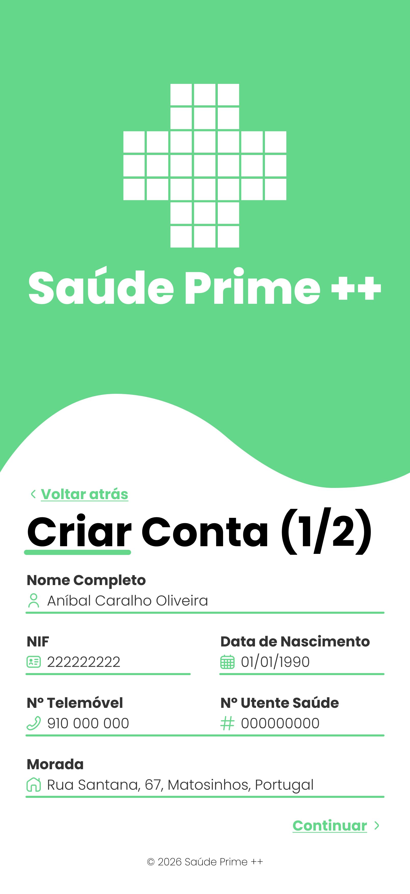  
</p>

<p align="center" justify="center">
  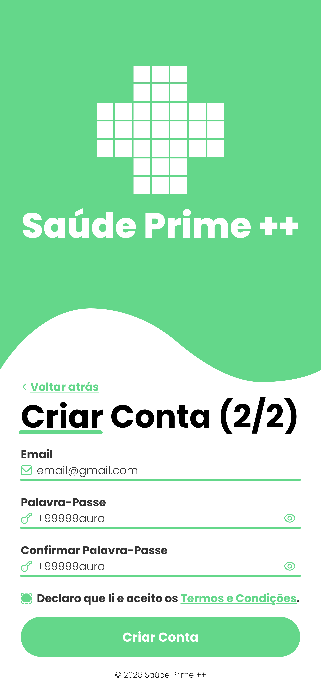  
</p>

<p align="center" justify="center">
  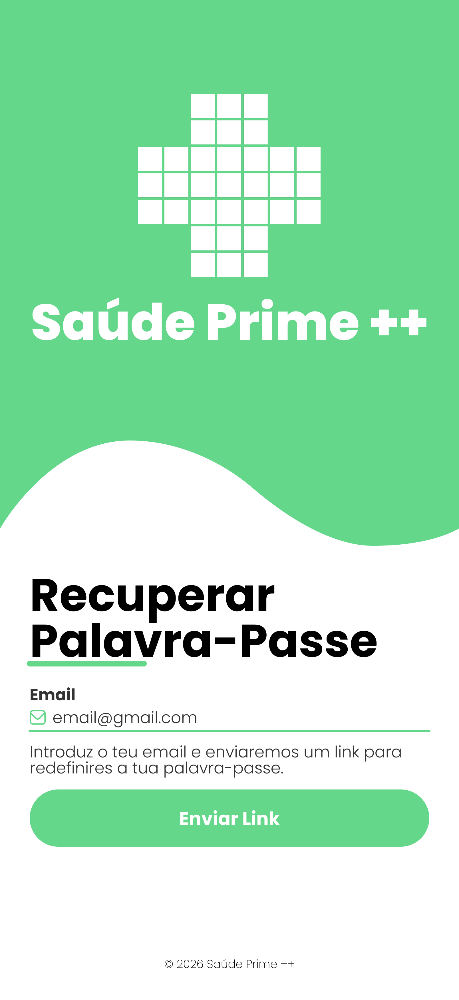  
</p>

<p align="center" justify="center">
  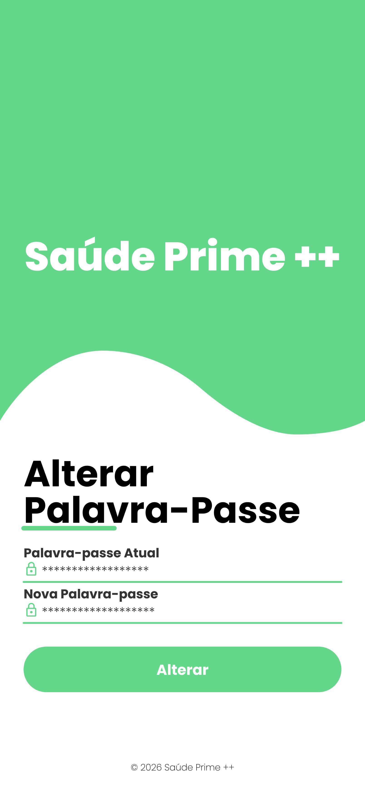  
</p>

<p align="center" justify="center">
  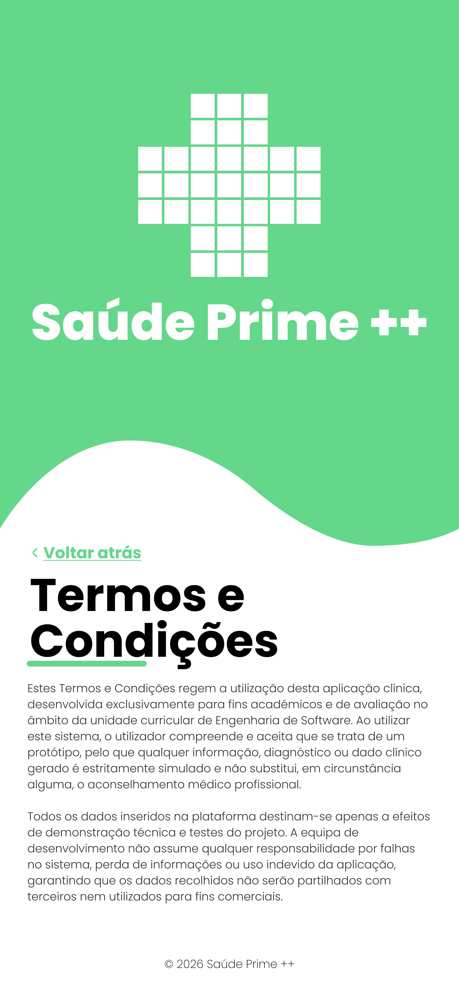  
</p>

**Portal do Paciente**

<p align="center" justify="center">
  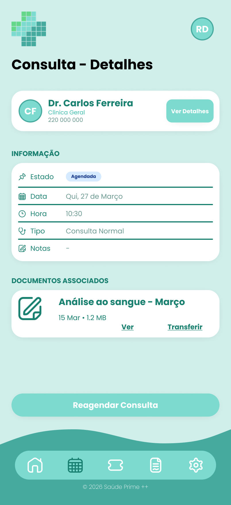  
</p>

<p align="center" justify="center">
  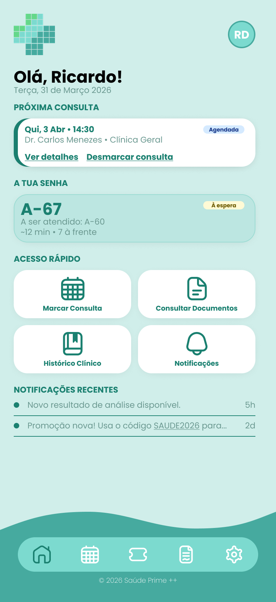  
</p>

<p align="center" justify="center">
  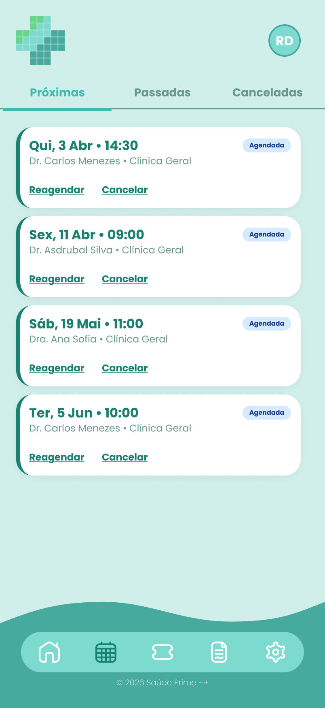  
</p>

<p align="center" justify="center">
  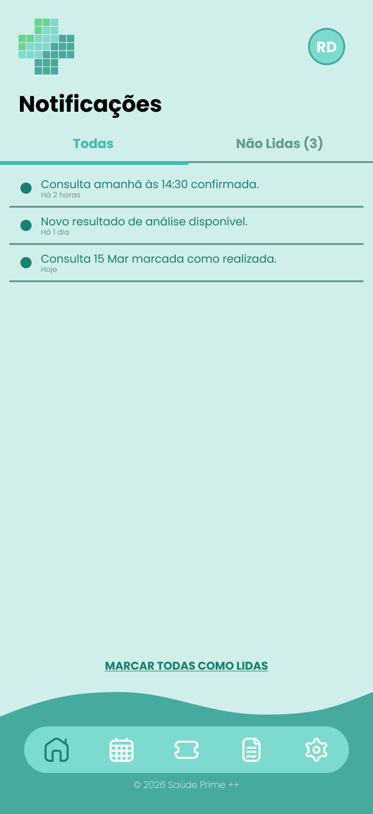  
</p>

<p align="center" justify="center">
  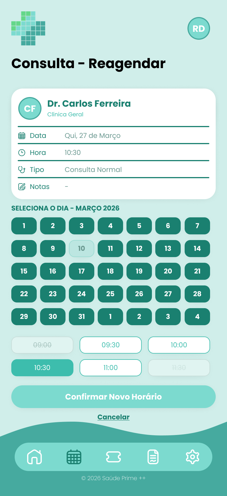  
</p>

<p align="center" justify="center">
  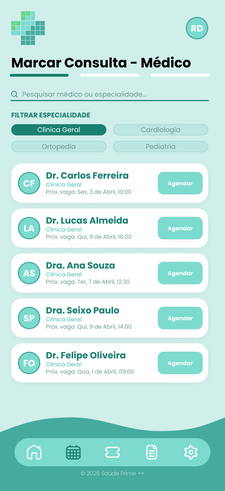  
</p>

<p align="center" justify="center">
  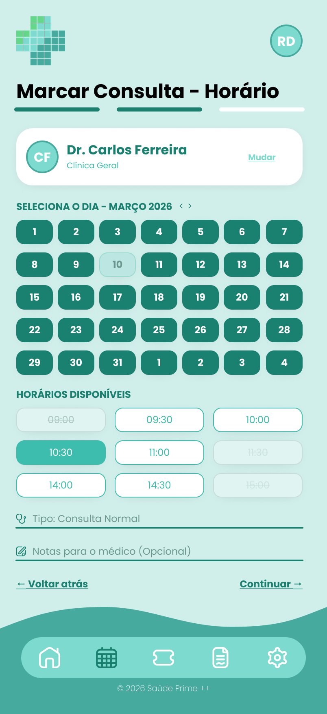  
</p>

<p align="center" justify="center">
  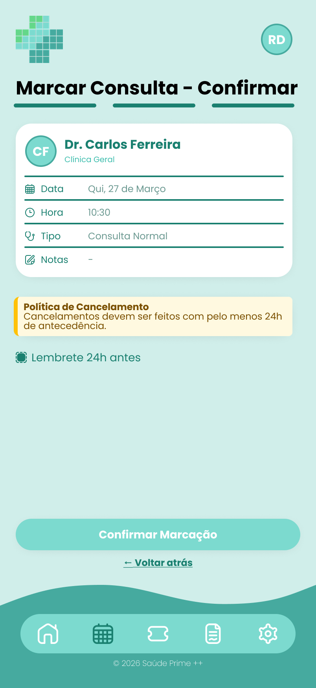  
</p>

<p align="center" justify="center">
  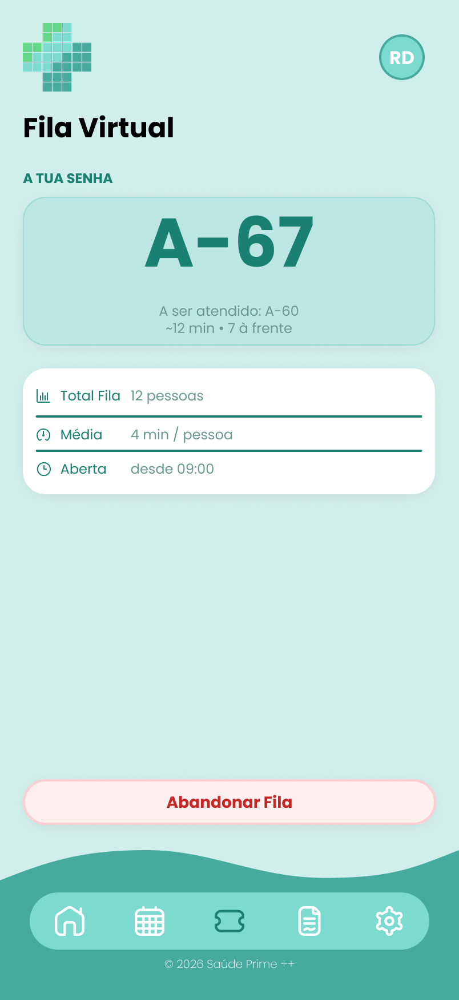  
</p>

<p align="center" justify="center">
    
</p>

<p align="center" justify="center">
  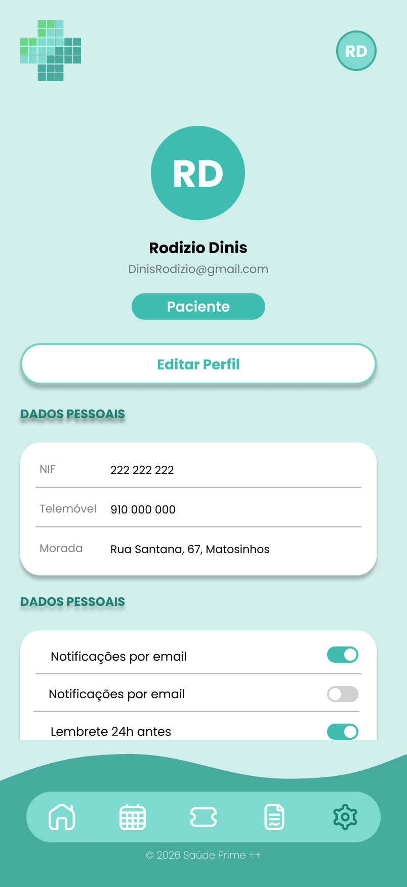  
</p>

<p align="center" justify="center">
    
</p>

<p align="center" justify="center">
    
</p>

**Portal da Receção**
<p align="center" justify="center">
  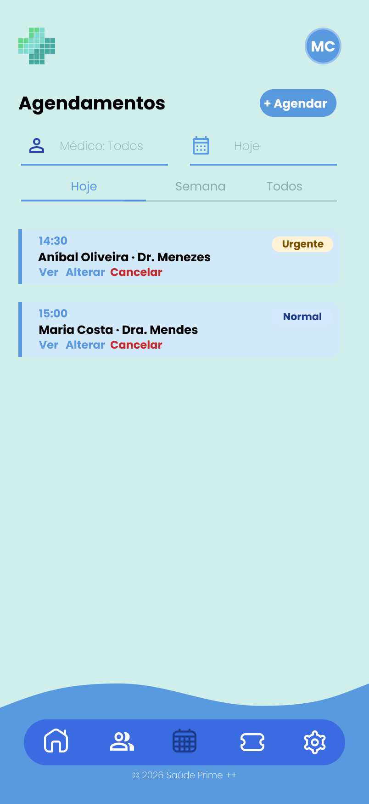  
</p>

<p align="center" justify="center">
      
</p>

<p align="center" justify="center">
      
</p>

<p align="center" justify="center">
     
</p>

<p align="center" justify="center">
      
</p>

<p align="center" justify="center">
      
</p>

<p align="center" justify="center">
      
</p>


**Portal do Médico**

<p align="center" justify="center">
    
</p>

<p align="center" justify="center">
    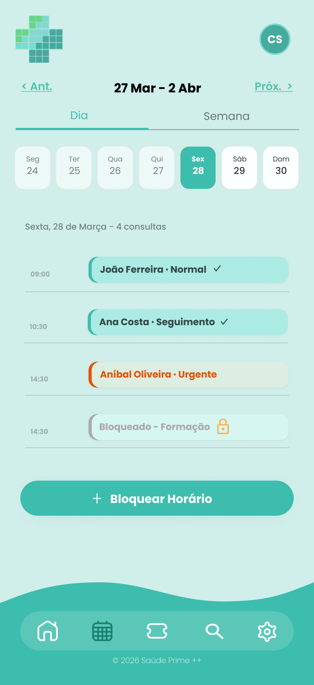  
</p>

<p align="center" justify="center">
      
</p>

<p align="center" justify="center">
     
</p>

<p align="center" justify="center">
    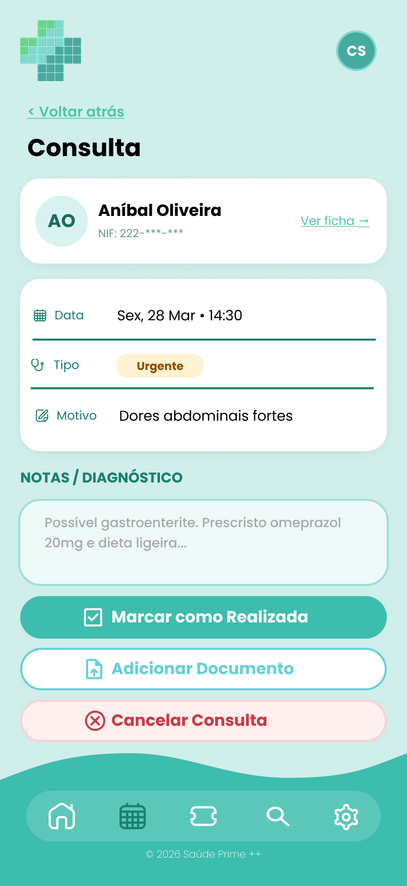  
</p>

<p align="center" justify="center">
      
</p>

<p align="center" justify="center">
      
</p>

<p align="center" justify="center">
     
</p>

<p align="center" justify="center">
     
</p>

**Portal do Admin**

<p align="center" justify="center">
      
</p>

<p align="center" justify="center">
      
</p>

<p align="center" justify="center">
      
</p>

<p align="center" justify="center">
      
</p>

<p align="center" justify="center">
     
</p>

<p align="center" justify="center">
    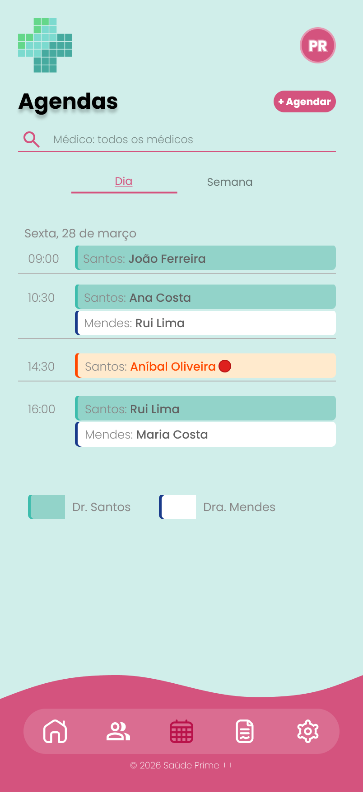 
</p>

<p align="center" justify="center">
     
</p>

<p align="center" justify="center">
     
</p>

<p align="center" justify="center">
      
</p>

## Acceptance Tests

**US1 - userRegistration**
```Gherkin
Scenario: Registo com sucesso
  Given que o utilizador não tem conta
  When introduz um NIF de 9 dígitos e um email único
  Then o sistema cria a conta e envia confirmação.
```

**US2 - updateProfileData**
```Gherkin
Scenario: Atualização de contacto
  Given que o paciente está autenticado
  When altera o contacto telefónico e clica em guardar
  Then a base de dados deve ser atualizada imediatamente.
```

**US3 - viewMedicalHistory**
```Gherkin
Scenario: Listagem cronológica
  Given que o paciente acede à página de histórico
  When o paciente solicita a visualização dos seus registos
  Then o sistema mostra data, médico e especialidade de todos os atos passados.
```

**US4 - searchDoctorBySpecialty**
```Gherkin
Scenario: Filtro de especialidade
  Given que o paciente está na área de pesquisa
  When o paciente filtra/pesquisa por "Cardiologia"
  Then o sistema lista apenas os médicos ativos nessa especialidade.
```

**US5 - newsletterSubscription**
```Gherkin
Scenario: Cancelamento de subscrição
  Given que o utilizador recebe um email de newsletter
  When clica no botão "Unsubscribe"
  Then o sistema remove o email da lista de envio.
```

**US6 - blockDoctorSchedule**
```Gherkin
Scenario: Bloqueio de agenda
  Given que o médico marcou um dia como indisponível
  When um paciente tenta agendar para esse dia
  Then o sistema mostra o horário como ocupado.
```

**US7 - scheduleAppointment**
```Gherkin
Scenario: Locking system em marcação simultânea
  Given que dois pacientes tentam o mesmo horário
  When o primeiro confirma a marcação
  Then o segundo recebe um aviso de que o horário já não está disponível.
```

**US8 - rescheduleAppointment**
```Gherkin
Scenario: Reagendamento com sucesso
  Given que o paciente seleciona uma consulta marcada
  When escolhe um novo horário disponível
  Then o sistema remove a antiga e confirma a nova reserva.
```

**US9 - downloadInvoice**
```Gherkin
Scenario: Download de PDF
  Given que a consulta foi paga
  When o paciente clica em descarregar fatura
  Then o ficheiro PDF deve conter os dados fiscais corretos.
```

**US10 - accessControlLevel**
```Gherkin
Scenario: Restrição de perfil Secretaria
  Given que o utilizador tem perfil de Secretaria
  When tenta aceder a notas médicas confidenciais
  Then o sistema nega o acesso.
```
**US11 - estimatedWaitTime**
```Gherkin
Scenario: Cálculo de tempo médio
  Given os tempos dos últimos 5 atendimentos
  When o paciente consulta a aplicação
  Then o sistema exibe a média aritmética desses tempos.
```

**US12 - exportInsuranceReport**
```Gherkin
Scenario: Exportação para seguradora
  Given que existem atos médicos faturáveis
  When o admin exporta para XML/CSV
  Then o ficheiro deve estar no formato standard da seguradora.
```
US13 - passwordRecovery
```Gherkin
Scenario: Expiração de link de reset
  Given que o utilizador solicitou reset há mais de 30 minutos
  When tenta usar o link
  Then o sistema informa que o link expirou.
```
US14 - cancelAppointment
```Gherkin
Scenario: Cancelamento fora do prazo
  Given que faltam apenas 12h para a consulta
  When o paciente tenta cancelar
  Then o sistema impede o cancelamento e informa sobre a regra das 24h.
```
US15 - notificationTriggerOnResult
```Gherkin
Scenario: Notificação de exame
  Given que um novo PDF é associado ao perfil
  When a notificação é disparada
  Then o corpo do texto não deve revelar dados sensíveis do diagnóstico.
```

-------
## Value and Effort
| ID | Esforço | Valor (MoSCoW) |
| :--- | :---: | :--- |
| **US1** | M | MUST HAVE |
| **US2** | S | MUST HAVE |
| **US3** | M | COULD HAVE |
| **US4** | S | SHOULD HAVE |
| **US5** | XL | WILL NOT HAVE |
| **US6** | M | MUST HAVE |
| **US7** | L | MUST HAVE |
| **US8** | L | SHOULD HAVE |
| **US9** | L | MUST HAVE |
| **US10** | L | MUST HAVE |
| **US11** | L | COULD HAVE |
| **US12** | M | SHOULD HAVE |
| **US13** | XL | WILL NOT HAVE |
| **US14** | XL | WILL NOT HAVE |
| **US15** | XL | WILL NOT HAVE |
